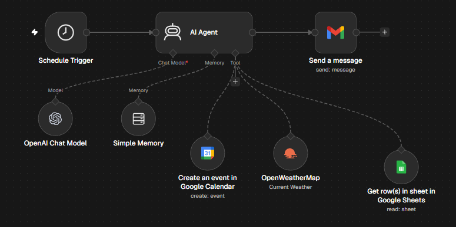
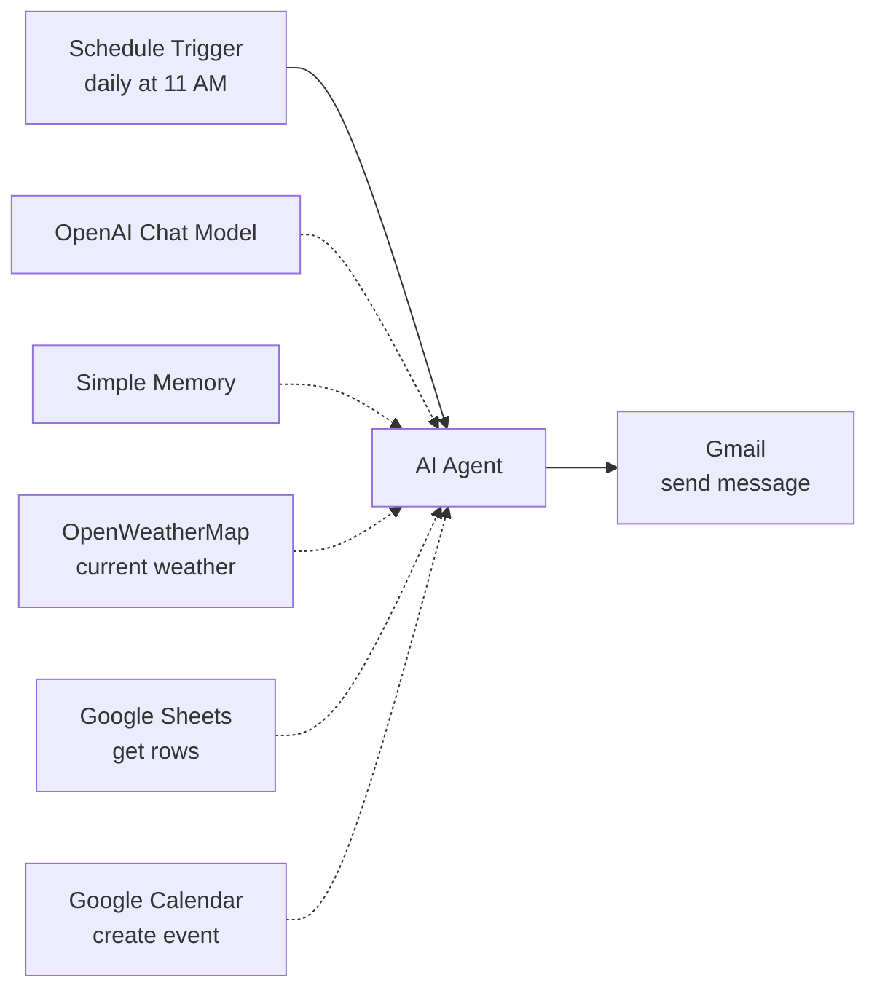
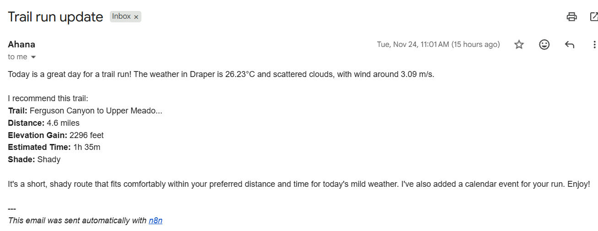

# AI-Powered Trail Run Assistant (n8n)

An AI agent built in **n8n** that checks the weather every day at 11 AM, decides whether it is a good day for a trail run, emails the recommendation and, when conditions are suitable, adds the run to Google Calendar.

## What it does

1. **Schedule Trigger** starts the workflow every day at 11 AM.
2. The **AI Agent** (OpenAI chat model with short-term memory) gathers information by calling its tools:
   - **OpenWeatherMap** to get the current weather.
   - **Google Sheets** to read stored data (<!-- TODO: say what your sheet holds, e.g. trail details or preferences -->).
   - **Google Calendar** to create a trail run event when the day is suitable.
3. **Gmail** sends a personalised email with the agent's recommendation.

## Architecture

## Components

| Node | Role |
|---|---|
| Schedule Trigger | Runs the workflow daily at 11 AM |
| AI Agent | Decides which tools to call and writes the recommendation |
| OpenAI Chat Model | Language model that powers the agent's reasoning |
| Simple Memory | Keeps recent context for the agent |
| OpenWeatherMap | Tool: fetches current weather conditions |
| Google Sheets | Tool: reads rows from a spreadsheet |
| Google Calendar | Tool: creates a calendar event |
| Gmail | Sends the final email |

## Example output

<!-- TODO: add a screenshot of the email you received and the calendar event (blur personal details) -->

## Agent prompt

The system prompt used by the agent is in [`prompts/agent-system-prompt.md`](prompts/agent-system-prompt.md).

## Setup

1. Install or open [n8n](https://n8n.io) (cloud or self-hosted).
2. Import `workflow/trail-run-assistant.json` (Workflows > Import from file).
3. Create credentials in n8n for:
   - OpenAI API key
   - OpenWeatherMap API key
   - Google OAuth2 (Gmail, Google Calendar, Google Sheets)
4. Select your own Google Sheet, calendar and email address in the relevant nodes.
5. Set the schedule (cron `0 11 * * *`) and your timezone in the Schedule Trigger.
6. Activate the workflow.

No secrets are stored in this repository.

## Tech

n8n, OpenAI, OpenWeatherMap API, Gmail, Google Calendar, Google Sheets

## Future improvements

- Add trail-condition data such as air quality and sunrise and sunset times.
- Send the recommendation to Telegram or WhatsApp as well as email.
- Log each day's decision to Google Sheets to track history.
